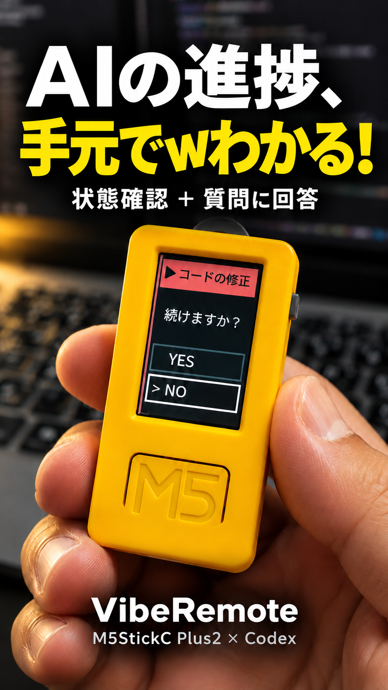

# GarVibeRemote-M5StickC

<p align="center">
  
</p>

PCから離れている間も、M5StickC Plus2でCodexの状態を確認し、チャットの選択式質問に回答するアプリです。
**Cで選択、Aで決定、Bでセッション一覧**。複数のローカルCodexチャットを監視し、切り替えて回答できます。
長い質問と選択肢は縦に自動スクロールします。
通信はBluetooth Classic SPP、またはUSBシリアルです。実機から元のチャットへの回答まで動作確認しています。

通常の導入は、以下の実機向け手順を使ってください。**シミュレータの起動、Emscripten、WSLは不要です。**
開発用Webシミュレータは[後半](#開発者向けwebシミュレータ)に分けています。

## AIに導入を頼む

ローカルのファイルと端末を操作できるAIへ、このリポジトリのREADMEを渡し、次のように依頼してください。
まだ取得していない場合は、[リポジトリ](https://github.com/ThousandsOfTies/GarVibeRemote-M5StickC)のURLも渡します。

```text
GarVibeRemote-M5StickCを、このWindows PCとM5StickC Plus2へ導入してください。
README.mdの「導入を担当するAIへ」と、そこから参照される手順書を読んで進めてください。
シミュレータは省略し、実機での状態監視と、このCodexチャットの選択式質問への回答まで接続してください。
既存アプリをバックアップしてから、このリポジトリのPlus2用ファームウェアを書き込んでください。
監視するプロジェクトとチャット、USBとBluetoothのCOM番号は、この環境で確認してください。
監視範囲を「同じプロジェクト」「このPCの全プロジェクト」「指定チャット」から確認してください。
USBケーブルの接続、ペアリングの番号照合、Hookのレビュー、実機のボタン操作は私に案内してください。
そのほかのコマンド実行や設定生成は進め、実機から元の質問に回答が戻ったことを確認して結果を報告してください。
不足する条件があれば、何が足りず、どこまで完了したかを説明してください。
```

導入作業を任せるAIと、監視するCodexチャットは区別します。**質問連携の実行には、ローカルCodex Appの接続機能が必要です。**
別のAIアプリや通常の端末だけでは`questions`を起動できません。Codex App内で続きの起動を行います。

## 必要なもの

| 項目 | 条件 |
| --- | --- |
| 実機 | **M5StickC Plus2**。初代StickC、StickC Plus、T-Watchには書き込まない |
| PC | Windows。無線利用にはBluetooth Classic SPPと発信COMポートが使えること。USB接続も使用可能 |
| ケーブル | 給電だけでなく**データ通信に対応したUSBケーブル** |
| PCのツール | Git、Python 3.10以上、Node.js 24以上とnpm、インターネット接続 |
| 監視対象 | ローカルで動くCodex。チャットの選択式質問連携はCodex Appを使用 |
| ソースの取得 | 本リポジトリと、公開submoduleの[gar-vibe-remote](https://github.com/ThousandsOfTies/gar-vibe-remote)、[gar-tools](https://github.com/ThousandsOfTies/gar-tools)をGitHubから取得できること |

共有ソースは公開submoduleです。`--recurse-submodules`で一緒に取得します。
導入時にPlatformIOやVS Codeを別途セットアップする必要はありません。ファームウェアのビルドに必要なツールはスクリプトが専用環境へ準備します。

## 導入を担当するAIへ

以下は、ユーザーから実機への導入を依頼されたAIの手順です。
シミュレータの先行開発や、旧T-Watchリポジトリからの移植は不要です。**この順で進め、各段階の結果を分けて確認してください。**

### 1. ソースと環境を確認する

新規取得では次を使います。既存のcheckoutがある場合は、その作業内容を保持して再利用してください。

```powershell
git clone --recurse-submodules https://github.com/ThousandsOfTies/GarVibeRemote-M5StickC.git
cd GarVibeRemote-M5StickC
# submoduleを取得していない既存checkoutの場合:
git submodule update --init --recursive
```

submoduleはProductで固定したコミットを使い、導入のために`--remote`で更新しません。
共有UIの変更は`gar-vibe-remote`の`main`へ統合しています。
実機のビルド対象は本Productの`firmware/stickc-plus2/platformio.ini`です。
最初に次を読みます。スキルをまだインストールしていなくても、リポジトリ内のファイルを直接読めます。

- [AGENTS.md](AGENTS.md)：このProductの作業範囲と共通ソースの扱い。
- [stickc-setup/SKILL.md](skills/stickc-setup/SKILL.md)：導入・再接続の作業手順。
- [Windows導入ガイド](docs/INSTALL.md)：PCの準備、設定、Hook、診断。
- [実機版ガイド](firmware/stickc-plus2/README.md)：Plus2用ビルド、バックアップ、書き込み。
- [SPP／USB接続ガイド](docs/DEVICE_CONNECTION.md)：ペアリング、中継、チャットの質問連携。

Git・Python・Node.js・npmの有無とバージョンを確認し、不足があれば必要な名前とバージョンを説明して準備します。
GitHubからの取得に失敗した場合は、ネットワーク接続とsubmoduleの取得状況を確認します。

以降のコマンドは**このリポジトリのルート**で実行します。PowerShellの変数は、次のように現地で確認した値を設定してから使います。
作者のPCのパス、COM番号、チャットIDをコピーしないでください。

| 変数 | AIが確認する内容 |
| --- | --- |
| `$MonitorProject` | ユーザーが監視したいプロジェクトの絶対パス。Productの保存先とは限らない |
| `$MonitorChatId` | 起動元のローカルCodexチャットID。Appのメタデータやチャット一覧から確認し、推測しない。複数監視でもこのIDを接続の起点にする |
| `$UsbCom` | `ports`でUSBとして現れる、接続したPlus2の書き込み用ポート |
| `$SppCom` | WindowsでPlus2に対応すると確認したBluetoothの**発信**ポート。USB用・着信用とは別 |

チャットを特定できない場合はユーザーに確認します。質問連携には明示した起動元チャットIDが必要です。
監視範囲も確認してください。以下は同じプロジェクトの例です。全プロジェクトなら`--session-scope local`へ変更します。

### 2. PCの実行環境を準備する

```powershell
python scripts/setup_remote.py doctor
python scripts/setup_remote.py prepare
python scripts/setup_remote.py test
python scripts/setup_remote.py install-skill
```

`doctor`で不足条件を確認し、`test`の`status: passed`、`scope: pc-loopback`を確認します。
**これはPC内の模擬試験であり、実機接続の成功ではありません。**
`install-skill`は`~/.agents/skills/stickc-setup`へ配置します。同名のスキルと内容が異なり停止した場合は、
勝手に上書きせず差分を確認します。リポジトリ内のスキルを読んで導入を続けることもできます。

### 3. Plus2へ書き込む

ユーザーが示した型番などから、本体が**M5StickC Plus2**であることと、データ通信できるUSB接続を確認します。
COM番号やUSBシリアルチップだけで型番を決めません。書き込みでは既存アプリを置き換えます。

```powershell
python scripts/firmware.py build
python scripts/setup_remote.py ports
# 確認したUSBのCOM番号を$UsbComへ設定してから実行:
python scripts/firmware.py identify --port $UsbCom
python scripts/firmware.py backup --port $UsbCom --model m5stickc-plus2
python scripts/firmware.py flash --port $UsbCom --model m5stickc-plus2
```

最初の書き込み前に8MBのバックアップとSHA256の記録を確認します。`flash`は自動バックアップを行いません。
バックアップや接続設定はこの利用者のPC内に保存し、他人のファイルを流用・公開しません。
書き込むのは`firmware/stickc-plus2`です。操作は本ProductのC選択／A決定／B一覧を使います。
デバイス接続はUSB／SPPに限定し、Wi-FiクライアントとLAN向けの探索・中継は削除しました。

### 4. ペアリングと実機の通信試験を行う

USBだけで利用する場合はペアリングを省略し、下記の通信試験をUSBで行います。
USBの通信試験を動かしている場合は、ペアリング前にその試験を停止します。
ユーザーへ次を案内してください。

1. Windowsの「Bluetoothとデバイス」から**GarVibe-M5StickC-Plus2**を追加する。
2. PCとPlus2の**6桁の番号**を照合する。同じ番号ならPlus2でC→YES→A、PC側でも確定する。固定PIN `1234`は使わない。
3. WindowsのBluetoothのCOMポート設定で、Plus2に対応する**発信ポート**を確認する。

確認した発信ポートを`$SppCom`へ設定して、他の実機中継が同じポートを使用していない状態で試験します。

```powershell
python scripts/setup_remote.py ports
python scripts/setup_remote.py device-test --port $SppCom --transport spp
```

ユーザーがCでYES／NOを選び、Aで決定した結果を受信します。
`deviceInput: received`と`source: m5stickc-plus2-spp`が実機入力の確認です。
`status: passed`だけで判断せず、`deviceInput: not-checked`ならボタン入力は未確認として扱います。
USBで使う場合は`$UsbCom`と`--transport usb`に置き換えます。USBとSPPの操作用中継は同時に動かしません。

### 5. 監視するプロジェクトとチャットを設定する

```powershell
python scripts/setup_remote.py configure --project $MonitorProject --session-id $MonitorChatId --label "作業名" --session-scope project --chat-questions
python scripts/setup_remote.py hooks --project $MonitorProject
```

設定は`artifacts/connection/local.json`へ生成します。トークンは自動生成され、再実行時も保持されます。
ユーザーにトークンの入力を求めたり、ログ・公開ファイル・URL・ファームウェアへコピーしたりしません。
既存の他のHookは保持します。旧ProductのHookの置換は、移行が依頼された場合だけ接続ガイドに沿って行います。

ユーザーに、**監視対象のCodex側で新規・変更したHookをレビューして信頼する操作**を案内します。
定義を書いただけではレビュー済みになりません。信頼記録の直接編集や承認チェックの無効化は行いません。
通常の質問連携とツール実行の承認は別です。`watchInput`は無効のままにします。

### 6. 3つの処理を並行して起動する

既存の同じProduct・設定の処理が動いていれば状態を確認し、重複起動を避けます。
次のコマンドはどれも動き続けるため、**別々の端末またはAIの実行セッション**で起動してください。
AIは起動したプロセスとログの保存先を把握し、他の用途のサービスを停止してポートを空けません。

| 処理 | コマンド | 役割 |
| --- | --- | --- |
| PC状態ブリッジ | `python scripts/setup_remote.py bridge` | Hookの状態と質問を認証付きで配信する。既定はlocalhost:39275 |
| 実機中継 | `python scripts/setup_remote.py device --port $SppCom --transport spp` | PCブリッジとPlus2のSPP通信をつなぐ |
| 複数チャットの収集・質問連携 | `python scripts/setup_remote.py sessions` | 許可した範囲のチャット一覧・状態・選択式質問を取り出し、実機回答を元のチャットへ返す |

**`sessions`はCodex App内のローカル実行機能から起動します。** App Toolsへの接続情報が環境に提供されることが必要です。
通常のPowerShellにその情報がない場合は、Codex Appへ起動を依頼してください。
接続情報を捏造したり、Codexの画面を自動クリックする代替方式へ切り替えたりしません。
通常の実機利用ではHTTPサーバやシミュレータを起動しません。
1チャットだけを固定する場合は`--session-scope single`で設定し、`sessions`の代わりに従来の`questions`を使います。

### 7. 元のチャットまでの往復を確認する

導入完了と報告する前に、次を確認します。

- `doctor`でPCブリッジへ接続でき、複数監視では`collectorReady: true`と監視対象を確認できる。
- 実機中継の`device-ready`を確認でき、ユーザーが実機の表示とA／B／Cの操作を確認した。
- 対象Codexで実際に作業し、実行中・待機中などの状態変化が実機へ届く。
- **対象チャットで新しい選択式の確認質問を出し**、ユーザーが実機のC→Aで回答する。PC側のカードは押さない。
- `chat-answer-delivered`の`source: m5stickc-plus2-spp`（USBでは`m5stickc-plus2-usb`）と、**回答が同じチャットへ届き、AIがその回答を使ったこと**を確認する。PC側の質問カードも回答済みになって閉じることを確認する。
- 複数チャットを使う場合は、別々の実チャット2つの質問が一覧に入り、B→C→Aで切り替えて回答した結果が、それぞれの元の質問へ1回ずつ戻る。

PC内の試験、実機専用の試験用質問、チャットの本物の質問は分けて報告します。
AIが仮の回答を注入した結果を、ユーザーの実機操作や別の操作への許可として扱いません。
最後に「PC準備／書き込み／実機通信／状態通知／チャットへの回答」の完了・未確認を分け、
再起動時の起動コマンド、監視先、使用COM番号、ログの場所を利用者へ残してください。秘密の値は報告しません。

## 手元で必要な操作

| 利用者が行うこと | AIが担当すること |
| --- | --- |
| USBケーブルを挿し、本体の型番を確認する | ポート確認、ビルド、バックアップ、書き込み |
| PCと実機の6桁番号を比較し、ペアリングを確定する | 手順案内と発信COMポートの確認支援 |
| CodexでHookをレビューして信頼する | 既存の設定を保持したHook定義の生成 |
| 実機の画面を確認し、C／A／Bを押す | 実機由来の受信ログと元のチャットへの反映の照合 |

コマンド実行をすべて利用者へ丸投げする意味ではありません。ローカル操作できるAIが準備と設定を進め、
物理的な接続や利用者本人の確認が必要な場面だけ、具体的に案内する想定です。

## 次回の起動・うまく動かないとき

次回はAIへ「このREADMEとstickc-setupを読んで、保存済み設定で実機接続と質問連携を再開して」と依頼できます。
通常は再書き込み・再ペアリング・Hook再登録は不要です。複数監視では範囲内で新しく開いたチャットを自動検出します。
監視範囲や起動元チャットを変えたい場合は設定を更新し、対象の収集処理を起動し直します。
Codex Appを再起動した場合、質問連携もそのAppから起動し直します。Windows再起動後は3つの処理の起動状態を確認します。

| 状況 | 最初に確認すること |
| --- | --- |
| clone／submodule取得に失敗 | 本体と共有2リポジトリの取得権限。シミュレータ導入で回避しない |
| USB用COMがない | データ通信対応ケーブル、本体の電源、接続ポート。BluetoothのCOMへ書き込まない |
| OFFLINE／`serial-open-failed` | 実機の電源、ペアリング先の発信COM、同じポートを使う別の中継 |
| 接続済みだが状態が変わらない | 監視先のプロジェクト／チャットID、Hookの実行とレビュー状況 |
| 状態は届くがチャットの質問は届かない | `--chat-questions`での設定、`sessions`（単一監視は`questions`）の動作、Codex Appの接続機能。15分以上前の質問ではなく新しい質問で試す |
| 回答の送達が不明 | PCの元の質問を確認する。不明な回答は自動再送しない |

詳細な診断は[Windows導入ガイド](docs/INSTALL.md)と[SPP／USB接続ガイド](docs/DEVICE_CONNECTION.md)を参照してください。

## 対応範囲

PC連携は**このPCのローカルCodexを最大16チャット**まで扱います。`single`、`project`、`local`、`manual`で範囲を選べます。
ChatGPTの通常チャット、クラウド・別PCのCodexは含めません。通常は起動中のチャットを収集し、閉じた履歴で一覧を埋めません。
収集はApp Toolsの「直近50件＋ピン留め」の一覧を入口にします。すでに採用したチャットは個別に再確認して維持しますが、
一覧の外にある新規対象はピン留めまたは`manual`で指定してください。16件を超えると既存枠を保持し、空いた枠へ追加します。
詳しい範囲指定と制限は[複数セッションの手順](docs/DEVICE_CONNECTION.md#5-複数のcodexチャットを監視する)を参照してください。
チャット質問連携はCodex Appの`request_user_input_async`が対象で、自由記述・同期型`request_user_input`・ツール実行承認はPCで扱います。
ローカル履歴、App Tools、ローカルのチャット連携IPCの形式に依存し、2026-10-26時点では
Codex App 26.1021.3705.0で実機往復と、元の質問が回答済みになることを確認しています。
状態の収集はApp Tools、回答は`native_chat_reply.cjs`が通常のユーザー回答として渡す経路を使います。
実行中は既存ターンへの返信、終了後は同じチャットの次のターンとして送り、PCの質問カードも完了します。
このIPCは版に依存する内部接続です。互換性を確認できない場合は送信せず、PCで回答してください。
以前の`send_message_to_thread`経由への自動切り替えや、送達不明な回答の再送は行いません。
異なる版で動かない場合は互換性の未確認として切り分け、成功したことにしないでください。
BLE、Copilot／Claudeなど他クライアント専用の連携、長時間利用時の電池寿命の検証は含まれていません。

## 開発者向け：Webシミュレータ

ここからは開発・UI確認用です。通常の実機導入では省略します。
Python 3.10以上、Node.js 24以上、Emscriptenが必要です。共有リポジトリもsubmoduleとして取得します。

```powershell
git clone --recurse-submodules https://github.com/ThousandsOfTies/GarVibeRemote-M5StickC.git
cd GarVibeRemote-M5StickC
# Emscriptenを有効にした環境で一度ビルド
python scripts/build.py
# WSLにEmscriptenを用意してあるWindowsでは代わりに:
# python scripts/build.py --wsl Ubuntu-26.04
python scripts/simulate.py --port 8772
```

[シミュレータを開く](http://127.0.0.1:8772/)。UIソース変更後は再ビルドしてページを再読み込みします。
実機と同じCodexの本番状態を表示する場合は、別端末で`python scripts/setup_remote.py simulator-feed`を起動し、
[本番表示](http://127.0.0.1:8772/?live=1)を開きます。閲覧専用で、回答は実機から行います。
接続トークンはPC内の中継だけで使います。試験データの画面は通常のURLで引き続き使用できます。
依存ライブラリは`dependencies.json`のバージョン・SHA256で検証して取得し、`.cache`へ保存します。
生成WASMは`simulation/runtime`に置き、Gitには含めません。

Emscriptenの新規導入は[公式手順](https://emscripten.org/docs/getting_started/downloads.html)を参照してください。
`--wsl`はそのWSLのPATH、または`~/.cache/gar-ui/emsdk/emsdk_env.sh`を使用します。
HTTPサーバは静的ファイルの配信だけを行います。Hookの変更や中継の起動は行いません。

## 操作

液晶は**135×240の縦向き、タッチ非対応**。実機では物理ボタンを短押しします。
シミュレータでは本体上のA/B/Cをマウスで押すか、ボタンにフォーカスした状態でA/B/Cキーを使います。
液晶のクリックでは回答は送信されません。本番表示のシミュレータは閲覧専用です。

| 場面 | A | B | C |
| --- | --- | --- | --- |
| 本文・回答 | **選択中の回答を決定・送信** | セッション一覧を開く | 次の選択肢へ（循環） |
| セッション一覧 | **選択中のセッションへ切り替える** | 切り替えずに戻る | 次のセッションへ（循環） |

YES／NOの接続試験ではNOを初期選択。チャットの選択肢は先頭を初期選択し、Cでフォーカスが一巡します。
Aは短押しして離すと決定します。質問の変更・切断・フォーカス喪失では押下を無効化します。
一覧を開く操作と一覧内の移動・切り替えは、本文や状態の更新だけでは取り消しません。
通常は **入力待ち ＞ エラー ＞ 実行中 ＞ 待機中** の優先度で表示を自動選択します。
待機中に別の実行が始まれば、そのセッションへ移ります。同じ優先度なら現在の表示を維持します。
回答の選択中・一覧の操作中・ボタン押下中は自動切替を止め、質問の回答・終了後に再開します。
回答の受信確認と表示中の作業完了は2秒間、一覧から手動で開いた状態画面は10秒間保持します。
入力待ちとエラーは作業完了の表示より優先します。回答後の質問は受信した順に選びます。
本文は9px/秒（日本語で約3文字/秒が目安）で縦スクロールし、先頭1.8秒・末尾2.8秒停止して繰り返します。
収まる文章は動きません。本文と独立して選択肢を固定表示します。
本文の背景は黒、枠は実行中が緑、入力待ち／エラーが赤、待機／完了がグレーです。
セッション名は枠と同じ緑・赤・グレーの背景に黒文字で表示し、一覧にも適用します。
外枠は液晶端から2px内側に4px幅で描き、実機とシミュレータで共通です。
通常URLのWebシミュレータの初期画面は3つの模擬セッションです。B→C→Aで切り替えられます。
自動切替でも各セッションの読み位置と選択位置は保持します。
「待機中」から「別セッションで実行開始」→「別セッションに質問を追加」で、優先度による移動を試せます。
長文・短文・複数選択肢・実行中・待機中・完了・エラー、切断と再接続、受信エラーを試せます。
模擬PCの受信結果は画面右側（狭い画面では下側）で確認できます。
Cは2秒以上押して離すと電源ON、6秒以上でOFFも試せます。実機の電源動作の完全再現はしていません。

## 開発時のUI構成と責務

```text
simulation/adapter.mjs  ── sessions / state / ack ──▶ C++ CompactUi (WASM / LVGL 7)
    模擬PC・シナリオ    ◀──── uiAction ──────────      │ 135×240 pixels
              ▲                             ▼
              └──── 物理ボタンedge ── <gar-stickc-plus2> + canvas
```

- `sources/gar-tools/web-simulator/components/m5stickc-plus2.mjs`：再利用可能な筐体・LCD境界・物理ボタン。
- `sources/gar-vibe-remote/vibe-remote/compact-ui/`：C++によるLVGL描画、自動スクロール、状態の優先度による自動選択、セッション一覧、回答の選択と決定。
- `simulation/`：Product固有の文面・模擬PC・接続条件・画面構成。
- `scripts/simulate.py`：共通HTTPサーバへの薄い入口。
- `hardware/binding.json`：Plus2の画面・ボタン対応。

入力は既存VibeRemoteの`state`形式と、全件を渡す`sessions`形式です。
出力`uiAction`とackにはセッション・質問・回答IDを付け、別セッションの回答と照合します。
16セッション・各8選択肢まで保持できます。形式の詳細は共有Appの`compact-ui/README.md`を参照してください。
SPP／USBともID付きackと8秒の接続期限を使用します。
`scripts/device_bridge.cjs`が既存Codexブリッジの状態・回答を新画面へ接続し、切断時には再同期します。
USB実機で表示・自動スクロール・A/B/C操作・回答の往復を確認済みです。
PCブリッジは設定した監視範囲から最大16セッションを配信します。長時間利用時の電池寿命は未確認です。
初代StickC、StickC Plusの実機互換は保証しません。

## 開発時のPC側コード構成

| ファイル（`scripts/`） | 役割 |
| --- | --- |
| `setup_remote.py` / `remote_config.py` | 起動コマンド・依存の準備／設定ファイル・Hookの編集 |
| `pc_config.cjs` | Nodeの各起動コマンドで共通の設定検証 |
| `chat_questions.cjs` | 単一チャット／複数チャットの起動先を選ぶ入口 |
| `session_monitor.cjs` | チャット一覧と状態の収集・各チャットの質問処理の管理 |
| `native_question_log.cjs` | ローカル履歴の読み取り・質問と回答済みの判定。通信は行わない |
| `question_service.cjs` | 1チャット分の質問配信・実機回答の受信・送信記録 |
| `codex_app_client.cjs` | Codex Appの状態取得・返信可能なチャットの確認 |
| `native_chat_reply.cjs` | 元の質問を照合し、実機の選択を通常のユーザー回答として届ける版依存のIPC接続 |
| `device_protocol.cjs` | JSON Linesの読み取りと表示形式への変換。実機とWeb配信で共有 |
| `device_bridge.cjs` | USB／SPPとPCブリッジの中継 |
| `simulator_feed.cjs` | ブラウザへの閲覧専用配信。実機の中継には依存しない |

履歴解析、通信、CLIの起動は別のモジュールです。サービスからCLIを読み戻す循環参照を作らず、
画面・通信・設定を変更したときは、その責務を持つモジュールと検証を更新してください。
従来の起動コマンドはそのまま使用できます。

## 開発時の検証

```powershell
node --test tests/ui.test.mjs
node --test tests/device_bridge.test.cjs
node --test tests/simulator_feed.test.cjs
node --test tests/chat_questions.test.cjs
node --test tests/multi_session.test.cjs
node --test tests/pc_runtime.test.cjs
node --test tests/native_chat_reply.test.cjs
python -m unittest discover -s tests -p 'test_*.py' -v
# Emscripten有効時の通信部品テスト（生成先は.cache内）
em++ -std=c++17 -Ifirmware/stickc-plus2/include tests/device_link.cpp -sSINGLE_FILE=1 -sENVIRONMENT=node -sEXIT_RUNTIME=1 -o .cache/device-link-test.cjs
node .cache/device-link-test.cjs
# 共通部品の単体例（別ポートで起動）
python sources/gar-tools/web-simulator/serve.py --panel sources/gar-tools/web-simulator/examples/stickc-parts --port 8773
# 共通部品のブラウザ試験
python sources/gar-tools/web-simulator/serve.py --panel sources/gar-tools/web-simulator/tests/stickc-browser --port 8774
```

UI試験は実際のWASMとLVGL描画を使い、文字欠落、スクロール速度と位置保持、C／Aの選択と決定、
セッション切替、キャンセル、切断、セッション別ack、独立インスタンスを確認します。
PC側の試験は隔離した設定・仮の接続を使い、設定検証、起動失敗時の終了、送信直前の監視対象確認、
履歴内のユーザー回答判定、実機とWeb配信の依存関係も確認します。
部品単体例は縦・横の2台を独立して操作できます。Product adapterは部品のShadow DOMを参照しません。
シミュレータ起動中に`http://127.0.0.1:8772/tests/index.html`を開くと、Productのボタン入力から
模擬PCの受信確認までのブラウザ連携試験も実行できます。

ハードウェア参照：[M5Stack公式 StickC Plus2](https://docs.m5stack.com/en/core/StickC-Plus2)。
共通ソースはsubmoduleです。変更時は共有リポジトリを先にコミット・プッシュし、そのコミットをこのProductで固定します。

## ライセンス

本リポジトリの独自コードと文書は[MIT License](LICENSE)です。
著作権表示とライセンス文を残す条件で、使用・改変・再配布・商用利用を認めます。

submoduleと依存ライブラリには、それぞれの利用条件が適用されます。本体のMITをそれらへ上書きしません。
日本語フォントのデータは[SIL Open Font License 1.1](sources/gar-vibe-remote/vibe-remote/touch-ui/OFL.txt)です。
