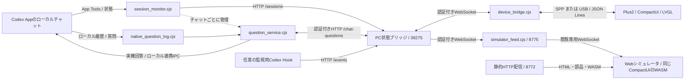
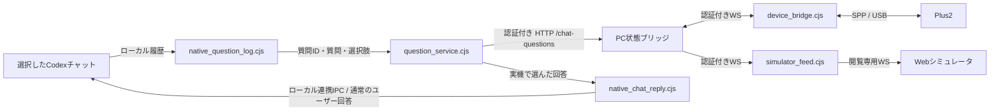

# Plus2とPCをSPP／USBでつなぐ

対象はM5StickC Plus2です。T-Watchの構成を参考に、Bluetooth Classic SPPの仮想COMポートで接続します。
USBシリアルも同じファームウェア・メッセージ形式で使用できます。BLEは未実装です。



状態ブリッジは従来どおりPCのlocalhostで動きます。デバイス中継はCOMポートへの接続と形式変換だけを担当し、
HTTPサーバ・シミュレータ・Hook変更・ペアリングを行いません。PC用の接続トークンはPC内で使い、実機へ送信・保存しません。
`chat_questions.cjs`は質問処理の起動入口で、単一監視なら1つの`question_service.cjs`、
複数監視なら`session_monitor.cjs`を起動します。シミュレータを経由せずに実機へ接続します。

## 1. ファームウェアとペアリング

[実機ガイド](../firmware/stickc-plus2/README.md)に沿って、Plus2をUSB接続して書き込みます。
Windowsの「設定 → Bluetoothとデバイス → デバイスの追加 → Bluetooth」で
**GarVibe-M5StickC-Plus2**を追加します。PCとPlus2に表示された**6桁の番号**を比較してください。
番号が同じなら、Plus2でCを押してYESを選び、Aで決定します。PC側でも接続を確定します。
番号が違う、または意図しない要求ならNOを選びます。30秒以内に完了しなければ中止します。
固定PIN `1234`は使いません。旧版で失敗した登録がWindowsに残っている場合は、そのPlus2の登録を削除してから追加し直します。
USBの中継が画面を操作している間は新しいペアリングを受け付けないので、中継を止めてから登録します。

「Bluetoothのその他の設定 → COMポート」で、この名前に対応する**発信ポート**を確認してください。
COM番号はPCごとに異なります。旧T-WatchのCOM3／COM4や、USBのCOM6を流用して判断しません。
`python scripts/setup_remote.py ports`はUSB／Bluetoothの分類を表示しますが、機種や発信方向までは判定しません。

## 2. 実機との独立した接続試験

Productルートで実行します。`COM_NUMBER`は確認した発信COM番号に置き換えます。

```powershell
python scripts/setup_remote.py prepare
python scripts/setup_remote.py device-test --port COM_NUMBER --transport spp
```

一時的なPC状態ブリッジを起動し、「実行中」から「入力待ち」への変化を実機から読み戻して検証します。
CでYES／NOを選び、Aで決定するとPC側に回答が返ります。試験は最大60秒で終了します。
`deviceInput: received`と`source: m5stickc-plus2-spp`が、SPP経由の実機入力を受けた証拠です。
`deviceInput: not-checked`は表示・接続だけの確認で、物理ボタン入力を確認したことにはなりません。
この試験は保存済みの接続設定・Hook・稼働中ブリッジを変更せず、回答を操作承認として扱いません。

USBで同じ試験をする場合は、USBのCOM番号と`--transport usb`を指定します。
USBとSPPの中継を同時に起動しないでください。実機は先に接続した側だけに操作権を渡し、もう一方へ`busy`を返します。
USBケーブルを給電用に挿しておくだけならSPP接続を妨げません。

## 3. 監視中のCodexへ接続

[PC導入ガイド](INSTALL.md)で設定とHookを準備し、状態ブリッジを起動してから中継します。

```powershell
# それぞれ別の端末で実行
python scripts/setup_remote.py bridge
python scripts/setup_remote.py device --port COM_NUMBER --transport spp
```

保存済み設定は`artifacts/connection/local.json`です。旧ブリッジを継続使用する場合は、
そのブリッジと同じトークン・ポートの設定ファイルを`--config PATH`で指定できます。
既存プロセスやHookを変更せず、読み取り用のクライアントとして接続します。

```powershell
python scripts/setup_remote.py --config "PRIVATE_CONFIG_PATH" device --port COM_NUMBER --transport spp
```

`sessionScope: single`では**選択した1セッション**の状態を配信します。未選択の場合は直近に観測したセッションです。
中継は毎回、正しいセッションIDを付けた`sessions`全件スナップショットへ変換します。
過去の状態を別セッションとして溜めたり、切り替わる前の質問へ回答したりしません。
複数の実チャットを自動収集する場合は、後述の[複数セッション設定](#5-複数のcodexチャットを監視する)を使います。

既存ブリッジの質問・接続試験のYES／NOは返信できます。導入支援は監視用Hookを生成し、実行承認を有効化しません。
長押しを要求する既存の承認UIは短押しAで承認せず、「PCで承認してください」と表示します。
Copilot監視や旧T-Watchのファームウェア／対話設定は取り込みません。

## 4. このチャットの選択式質問を実機へ通知する

通常のチャットで出す質問と、ツール実行の承認は別経路です。質問連携を有効にすると、
Codex Appの`request_user_input_async`が表示した選択肢をPlus2へ自動転送します。
Cで選び、Aで決定すると、元の質問IDと元の選択肢の文字列を使って同じチャットへ回答します。
返信は`native_chat_reply.cjs`からCodex Appのローカル連携IPCへ渡します。
元のチャットの最新の質問・選択肢・回答済み状態を照合し、通常のユーザー回答として送るため、
PCの質問カードも回答済みになります。実行中は`thread-follower-steer-turn`、終了後は
同じチャットへの`thread-follower-start-turn`を使い、モデルや権限設定は変更しません。
元の質問が別のターンへ移った場合や、PCですでに回答済みの場合は送りません。
質問が複数なら一問ずつ表示します。長い選択肢は本文にも番号付きで表示し、自動スクロールで読めます。

```powershell
python scripts/setup_remote.py configure --project YOUR_PROJECT --chat-questions
python scripts/setup_remote.py prepare
# PC状態ブリッジを新版で起動し直してから、Codex App内で別の処理として起動:
python scripts/setup_remote.py questions
```

`questions`はCodex Appから提供されるローカル接続を使用します。通常の端末に接続情報を
コピーする必要はありません。Codex Appへ「質問連携を起動して」と依頼できます。
SPP／USBの中継、状態ブリッジ、HTTP配信とは独立した処理です。Hook定義や信頼記録は変更しません。



- 上記コマンドは単一監視の例です。複数監視では、次節の範囲内にある各ローカルチャットの質問を独立して扱います。
- 自由記述、選択肢なし、8択を超える質問、本文と選択肢の合計が2,000文字を超える質問はPCで回答します。
  1回の質問要求は24問まで扱い、各セッションで一問ずつ表示します。200行を超える本文もPCで回答します。
- 新規質問から15分以内のカードを転送します。古いカードはPCに残り、履歴の再読込で復活させません。
- PCでの回答が履歴に記録済みなら、時計側の質問を取り下げます。送信直前にも再確認します。
- 連携処理から5秒間更新が途絶えると時計から回答できなくなります。送達が不明な回答は
  PC内の配信記録に残し、再起動後も自動再送しません。PCで回答済みか確認してください。
- `chat-answer-delivered`はCodex Appが通常のユーザー回答を受け付けた状態です。元の質問の完了処理もこの経路で行われます。
  `chat-answer-unconfirmed`は送達が不明で、自動再送しない状態です。ログへ質問文・回答文・トークンは出しません。
- シミュレータは閲覧専用です。実機の回答を試すときに、PC側の選択肢を押した結果を実機入力と取り違えません。
- ツール実行の許可・拒否や、同期型`request_user_input`への回答はこの実装の対象外です。

ローカル履歴、App Tools、連携IPCの接続形式はCodex Appの版に依存する互換アダプターです。
2026-10-26にCodex App 26.1021.3705.0で、SPP実機回答とアプリ内部の回答済み状態を確認しました。
連携IPCは公開された安定APIではありません。互換性を確認できなければ送信を止め、
従来の委譲メッセージへ自動切り替えしません。元の質問の状態と送達不明の記録を確認してください。
Appを再起動したら質問連携も起動し直してください。形式変更や接続不能時はPCで回答し、
画面の自動クリックや別の質問への代理入力へ切り替えません。

## 5. 複数のCodexチャットを監視する

ファームウェアと画面はそのまま使い、PCブリッジと収集処理を新版へ更新します。
`session_monitor.cjs`がApp Toolsでローカルのチャット一覧・状態を読み、`POST /sessions`で
最大16件の全件スナップショットを配信します。各チャットの質問は別の所有者・質問管理・配信記録で扱い、
実機からの`sessionId`・`uiId`・`actionId`を照合して、そのチャットへ元の質問ID付きの回答メッセージを返します。

| 監視範囲 | configureの指定 | 対象 |
| --- | --- | --- |
| 従来の単一監視 | `--session-scope single` | `--session-id`の1チャット。収集は`questions` |
| 同じプロジェクト | `--session-scope project` | `--project`と作業ディレクトリが一致する、ローカルCodex |
| このPCの全プロジェクト | `--session-scope local` | このPCで起動中のローカルCodex。別PC・クラウド・ChatGPTの通常チャットは除外 |
| 指定チャットのみ | `--session-scope manual --include-session CHAT_A --include-session CHAT_B` | 明示した1〜16件。IDごとのローカル実体を確認して収集 |

`--session-id`は起動元チャットとして複数監視でも残します。`manual`の対象リストへ自動追加はしません。
`project`はディレクトリの一致で判定します。別のworktreeやサブフォルダーも含めたいときは、`local`か`manual`を使います。
通常の複数監視では起動中のチャットを収集し、起動元だけは未読込でも表示できます。過去の全履歴を実機へ送るものではありません。

```powershell
# 既存の起動元チャットIDとトークンを保持して、全プロジェクトへ変更する例:
python scripts/setup_remote.py configure --project YOUR_PROJECT --session-scope local --chat-questions
python scripts/setup_remote.py prepare
# 自分が管理する旧ブリッジ・questionsを止め、別々の実行セッションで:
python scripts/setup_remote.py bridge
python scripts/setup_remote.py device --port COM_NUMBER --transport spp
# Codex App内から:
python scripts/setup_remote.py sessions
```

初回導入では`configure`に`--session-id ANCHOR_CHAT_ID`も指定します。
動いている実機中継が新版の状態形式を扱える場合はそのまま再接続させ、重複起動しません。
`sessions`は状態収集と質問連携をまとめた独立したPC処理で、HTTPサーバ・SPP・ファームウェア書き込みは起動しません。
`questions`を複数監視の設定で起動した場合も、同じ収集処理へ委譲します。両方を同時には起動しません。

- 一覧は約2秒間隔で更新します。選択はPlus2内で保持し、他チャットの通知で画面を奪いません。
  Bで一覧、Cで循環選択、Aで表示対象を決めます。質問の本文には、収まる場合にプロジェクトのフォルダー名も付けます。
- App Toolsの一覧取得は直近50件の非ピン留めチャットと全ピン留めチャットが入口です。
  すでに採用したチャットは一覧から外れても個別に再確認します。一覧の外にある新規対象は、
  ピン留めして開くか、`manual`でIDを指定してください。公開されている一覧APIの上限を回避するためにAppを改造しません。
- 16件が埋まっているときは既存枠を保持し、追加分は`overflow`へ数えます。既存対象がなくなって空きができた後に追加します。
- チャットごとの質問は5秒の更新期限、一覧の所有者は15秒の更新期限です。Appや収集処理が利用不能になれば
  回答を停止し、一覧の期限も切れたら「セッション一覧の接続待ち・PCを確認」を表示します。
- 64KiBの実機パケットへ16件を収めるため、表示量は1セッションあたり固定の予算にします。
  超える本文は末尾に「全文はPCで確認」を付けます。別チャットの文章量で、読んでいる本文や選択が伸縮しません。
- 回答の配信記録は`.gar/chat-questions/チャットID.json`へ分けます。同じ質問IDが別チャットに存在しても混線しません。
  `chat-answer-delivered`には送信元とチャットIDを記録します。質問文・回答文・トークンをログへ出しません。
- `local`では他プロジェクトの質問も実機に表示されます。実機を他人と共用する場合や表示範囲を絞る場合は`project`か`manual`を選びます。
  実行承認を自動化する機能は有効にしません。

状態はAppの実行状態を読み取るため、すべてのプロジェクトへHookを追加する必要はありません。
既存の監視用Hookが届くチャットでは、ツール実行前後などの詳細も受け取ります。収集処理がHookや信頼記録を書き換えることはありません。
`doctor`の`bridge.collectorReady`・`sessionCount`と、収集ログの`sessions-updated`・`overflow`で確認できます。

マルチセッションの結合試験は`node --test tests/multi_session.test.cjs`です。
仮の2チャット・仮のSPP・仮のApp返信で混線防止を自動確認します。**実チャット2つ＋実機での確認とは区別してください。**
本番の確認では別々のチャットに新しい質問を出し、実機の切替と回答が各カードに1回だけ反映されることを確認します。

## 通信と再接続

実機と同時にWebシミュレータへ本番データを表示する場合は、HTTP配信とは別のプロセスを起動します。

```powershell
python scripts/simulate.py --port 8772
# 別の端末:
python scripts/setup_remote.py simulator-feed
# http://127.0.0.1:8772/?live=1 を開く
```

`simulator-feed`はlocalhost:8775の閲覧専用WebSocketで、8772のページからの接続だけを受け付けます。
トークンはPC内で使い、配信ファイル・URL・ブラウザには渡しません。実機のSPP中継と同時に状態を購読できます。
本番表示のAは回答を送らず、PC側の中継もブラウザからのメッセージを転送しません。
本番へのYES／NOは実機から行います。通常のURLは従来の模擬試験です。
ポートを変える場合は`simulator-feed --port PORT --panel-port HTTP_PORT`と、URLの`livePort=PORT`を対応させます。

- USBもSPPもUTF-8のJSON Linesです。改行を除き1行64KiBまで。受信の区切りが日本語の途中でも処理します。
- `hello` → `deviceInfo`で機種・画面・プロトコル・通信方式を確認してから状態を送ります。
- `state`／`sessions`は状態、`uiAction`は回答、`ack`はセッション・質問・回答ID付きの受領確認です。
- 2秒ごとの`ping`と8秒の接続期限を使います。SPP切断や`goodbye`では即座に操作権を解放します。
- 定期的な`hello`／`deviceInfo`で実機の応答と操作権も確認し、途中の再起動・接続期限切れから復帰します。
- PCブリッジへの接続が切れた場合は、実機にも切断を伝えます。COM・WebSocketは3秒間隔で再接続します。
- 再接続では最新状態を取り直します。古い回答は自動再送せず、受領不明ならPCで確認してから選び直します。
- `snapshot`はUSBから状態を読むためにも使用でき、SPPの操作権を奪いません。

`serial-open-failed`は発信COM番号・ペアリング・他の中継の使用状況を確認します。
`device-busy`は別のUSB／SPP中継が操作中、`wrong-device`は機種またはファームウェアの不一致です。
ログには接続トークンや質問本文を出しません。

実装では、`device_protocol.cjs`が実機とWeb配信に共通する表示変換を担当し、
USB／SPPの接続は`device_bridge.cjs`、閲覧用配信は`simulator_feed.cjs`へ分けています。
質問は`native_question_log.cjs`で履歴を解析し、`question_service.cjs`でチャットごとに配信・回答を処理します。
起動コマンドとモジュールごとの責務は[READMEのPC側コード構成](../README.md#開発時のpc側コード構成)を参照してください。
