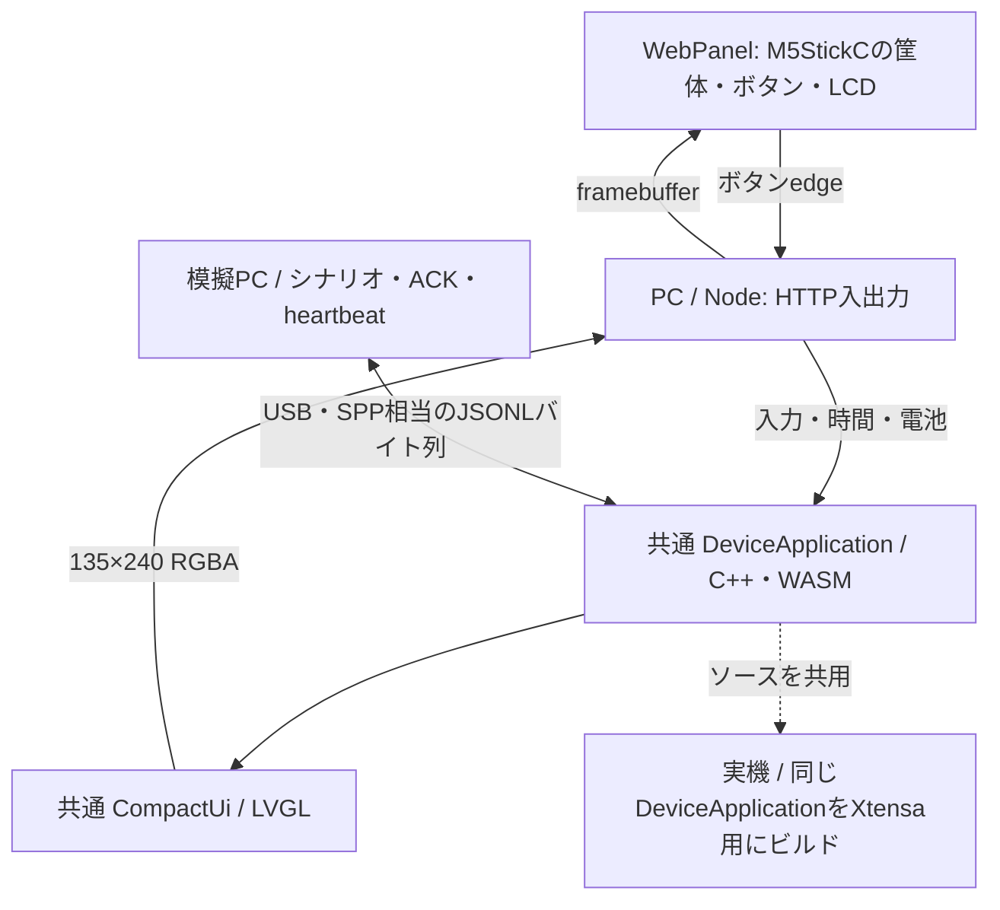

# VMを使わないシミュレータ

実機と同じC++の`DeviceApplication`を、Node上のWASMとして動かします。
ESP32のファームウェアバイナリをPCで動かす方式ではなく、同じアプリのソースをPC用にビルドします。
LCD・ボタン・バイト通信路・電池・時計を差し替え、UI、JSONLの受信、通信の所有権、
8秒の接続期限、ペアリングの確認・期限、回答の送出を共用します。

## GARで起動する

Productと固定済みsubmodule、GAR、Docker、PCのNode.js 24以上を用意します。
Dockerはビルド時だけ使用し、起動後のアプリはPCのプロセスです。VMやUSB接続は不要です。

`gar config`で既存workspaceを編集するか、Productのローカルフォルダーを登録します。
Targetは`esp32`、BuildEnvironmentは`local`（Docker）、SimulationEnvironmentは
`host_process`（Local PC application / Node・WASM）を選びます。
`build.cache: true`ならEmscriptenとコンパイル結果をworkspace専用Docker volumeへ保存します。
その他の実機・監視設定は変更しません。

```powershell
gar sim build --workspace Local/GarVibeRemote-M5StickC
gar sim deploy --workspace Local/GarVibeRemote-M5StickC
gar sim start --workspace Local/GarVibeRemote-M5StickC
gar sim diag --workspace Local/GarVibeRemote-M5StickC --json
```

[WebPanel](http://127.0.0.1:8772/)を開き、筐体上のボタンをクリックします。
Cが選択肢の移動、Aが決定、Bがセッション一覧です。液晶はタッチ非対応です。
回答は模擬PCで受信し、IDが一致するACKをアプリへ返します。
模擬USB／SPPの切り替え、切断・再接続、受信エラー、複数セッションも試せます。

```powershell
gar sim stop --workspace Local/GarVibeRemote-M5StickC
gar sim log --workspace Local/GarVibeRemote-M5StickC
```

変更後は停止し、build → deploy → startを実行してページを再読み込みします。
`deploy`は保存済みSIM_APPを配置し、再ビルドしません。`start`は配置済み成果物の固定コピーを起動します。
`diag`の`ok: true`と`build_id_match: true`、画面・回答往復の両方を確認してください。
別プロセスが8772を使用中なら起動を失敗させます。未知のプロセスを自動停止しません。
何も起動していないときの`diag`は停止状態を報告し、稼働成功にはしません。

GARがPATHにない場合は、取得したGARの`scripts/gar.cmd`をフルパスで呼び出します。
初回ビルドは固定版Emscripten 3.1.64とSHA256付き依存ライブラリを取得するため時間がかかります。
`.gar`、`.cache`、生成WASM、個人の設定をGitへ追加しないでください。

## 入出力の経路



WebPanelはアプリの状態を独自に計算しません。シナリオも`hello`→`sessions`、
定期的な`ping`、回答後の`ack`をバイト通信路へ流します。
共有部品は`sources/gar-tools/web-simulator/components/`、Productの意味と模擬PCは
`simulation/host-controller.cjs`、HTTPは`host-server.cjs`、表示の接続は`adapter.mjs`です。
共通アプリは`sources/gar-vibe-remote/vibe-remote/device-app/`に置きます。
実機のI/Oは独立した基板submodule、Productの`main.cpp`はそのcallback接続です。
画面寸法は基板プロファイル、LVGLメモリ量と識別名は`product.json`から読みます。
[コンポジション](COMPOSITION.md)に構成と生成物をまとめています。

GARの汎用`host_process`はプロセスと成果物を管理し、VibeRemoteのメッセージを解釈しません。
成果物の`host-process.json`に起動先・ポート・health URLを宣言します。
GARはPID・起動時刻、起動ごとのinstance ID、build IDを照合します。
SIM_APPは`wasm32`／`emscripten`として記録し、ESP32用TARGET_APPと分けて保存します。
SIM_APPとTARGET_APPのビルドは同じ一時export領域を使うため、同一workspaceで同時に実行しません。

## 確認できる範囲

| 共通コードで確認するもの | 実機で確認するもの |
| --- | --- |
| UI、文字、スクロール、選択・自動切替 | LCDの色味、明るさ、見切れ |
| JSONL分割・上限・復帰、所有権と期限 | USB・Bluetoothドライバ、無線品質 |
| 質問とACKのID、操作中の取り消し | FreeRTOS・割り込み・Bluetoothコールバックの並行実行 |
| ペアリング確認・期限のアプリ処理 | Windowsと実機の認証・bond保存 |
| 模擬電池値・電源ジェスチャー | 消費電力・電池寿命・電源断後の起動 |

LVGLのヒープは実機と同じ48KiBです。PC側のC操作は画面・接続の模擬電源切り替えであり、
電源断によるメモリ初期化やESP32の完全な再起動を再現しません。
ペアリング処理の統合試験はC++ APIからイベントを注入し、OSのBluetoothスタックを動かしません。
模擬SPPはPC内のバイト通信路で、Bluetoothの実通信ではありません。

`?live=1`は既存の`simulator-feed`から受けた本番状態の閲覧用です。
本番の質問への回答・承認は実機かPCのチャットで行います。
模擬PCの回答と本番への送信処理を接続しません。Hookの変更や中継の起動も行いません。
1つのhost_processを複数タブで開くと同じ実行状態を共有します。

## 試験と開発用の入口

GARの`sim build`は共通アプリと、UI単体試験用の別モジュールを生成します。
後者は配布成果物に含めません。

```powershell
node --test tests/device_application.test.mjs tests/host_simulator.test.cjs tests/ui.test.mjs
python -m unittest discover -s tests -p 'test_*.py' -v
```

テストは実際のWASM・LVGLの画素と、模擬PCの受信を使います。
HTTPは`GET /api/state`、`GET /api/frame`（135×240 RGBAバイト列）、
`POST /api/control`、`GET /health`を公開します。制御はJSON、同一origin、loopbackに限定します。
`/api/control`の入力例は`{"type":"button","button":"C","phase":"down"}`、
続けて`phase: "up"`です。`wire`は隔離したJSONL試験用で、本番回答の送信先を持ちません。

SDKを有効化済みの開発環境では`python scripts/build.py`で共通アプリだけをビルドできます。
`python scripts/simulate.py --port 8772`は開発用プロセスへの薄い入口で、ビルドやサービス設定を行いません。
通常の再現・配置・診断にはGARの手順を使います。
